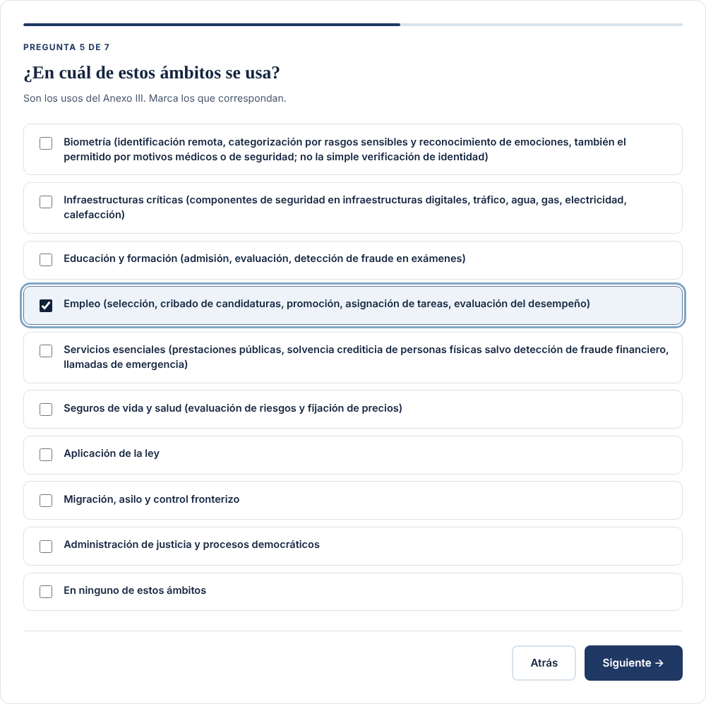
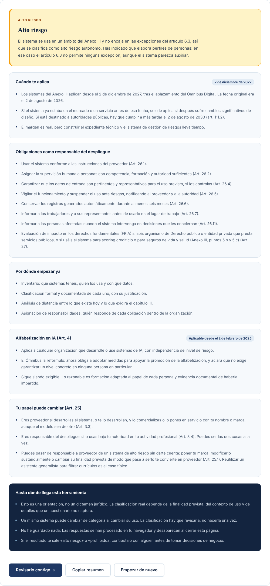

# Clasificador de riesgo del EU AI Act

Un cuestionario de once preguntas como máximo que orienta sobre el nivel de riesgo de un sistema de IA según el Reglamento (UE) 2024/1689 (EU AI Act), modificado por el **Ómnibus Digital, Reglamento (UE) 2026/1744**. Te dice tu papel (proveedor o responsable del despliegue), las obligaciones que te aplican y la fecha desde la que son exigibles.

Es la versión autónoma del [clasificador de formaciontech.es](https://formaciontech.es/clasificador-riesgo-ia/): una sola página HTML con su JavaScript y su hoja de estilos, sin servidor, sin registro y sin guardar nada. El cálculo ocurre entero en el navegador.

> **Contenido informativo; no es asesoramiento jurídico.** El resultado es una orientación basada en tus respuestas y no sustituye el análisis del contexto real de uso. Si te sale «alto riesgo» o «prohibido», contrástalo con tu asesoría legal antes de tomar decisiones.

**Última revisión: 9 de noviembre de 2026.**





## Cómo usarlo

- **En tu ordenador:** descarga el repositorio (*Code → Download ZIP*), descomprímelo y abre `index.html` con doble clic. Funciona sin conexión.
- **Con GitHub Pages:** en *Settings → Pages*, elige *Deploy from a branch*, rama `main` y carpeta `/ (root)`. La página quedará en `https://<usuario>.github.io/clasificador-riesgo-eu-ai-act/`.
- **En otra web:** copia `index.html`, `clasificador.js` y `estilos.css` a la misma carpeta de tu servidor.

Clasifica cada sistema por separado: el riesgo depende del uso concreto, no de la empresa ni de la marca de la herramienta.

## Qué pregunta y en qué orden

1. Tu relación con el sistema: lo desarrollas, lo construyes sobre un modelo ajeno, lo usas o ambas cosas.
2. Si usas un sistema ajeno, si le pones tu marca, lo integras, lo modificas o cambias su finalidad (arts. 3.3 y 25).
3. Si encaja en alguna práctica prohibida del artículo 5, incluidas las dos que añade el Ómnibus.
4. Si es componente de seguridad de un producto regulado del Anexo I, en qué sección y si necesita evaluación por un tercero (art. 6.1).
5. Si se usa en un ámbito del Anexo III; si elabora perfiles y si encaja en alguna excepción del artículo 6.3.
6. Las obligaciones de transparencia del artículo 50 y si desarrollas un modelo de propósito general (capítulo V).

El resultado indica uno de estos niveles: riesgo inaceptable, alto riesgo, pendiente de confirmar, posible excepción, riesgo limitado o riesgo mínimo. Las obligaciones de los modelos de propósito general se muestran aparte, porque no son un nivel de riesgo del sistema.

## Ficheros

| Fichero | Contenido |
|---|---|
| `index.html` | La página: textos, preguntas frecuentes y el contenedor del cuestionario. |
| `clasificador.js` | Las preguntas, el motor de clasificación y la interfaz. |
| `estilos.css` | Estilos propios, sin fuentes ni librerías externas. |
| `pruebas/prueba_navegador.py` | Prueba automática con Playwright. |
| `capturas/` | Las imágenes de este README, generadas por la prueba. |

## Diferencias con la versión de la web

Las preguntas, los textos y la lógica de clasificación son los mismos. Solo cambia esto:

- Se han quitado la cabecera, el pie y los scripts generales de la web; la página lleva un pie propio con el enlace a formaciontech.es.
- Los enlaces apuntan a direcciones completas de formaciontech.es, y se ha quitado el botón que llevaba a una demo de la web.
- El botón «Copiar resumen» funciona también al abrir el fichero en local: si el navegador no ofrece el portapapeles moderno, usa el método clásico.

## Pruebas

La función `clasificar()` no depende del navegador. En Node se puede importar para probarla con tus propios casos:

```js
const { clasificar } = require("./clasificador.js");
const r = clasificar({ rol: "responsable", cambios: ["ninguno"], prohibidas: [], producto: "no",
                       anexo3: ["a3"], perfilado: "si", transparencia: ["ninguno"], gpai: "no" });
console.log(r.nivel, "·", r.titulo);   // alto · Alto riesgo
```

La prueba de navegador recorre tres casos (una práctica prohibida, un cribado de candidaturas con perfilado y un chatbot propio sobre la API de un modelo) y comprueba que cada uno llega a su nivel esperado sin errores en la consola:

```bash
pip install -r pruebas/requirements.txt
python -m playwright install chromium            # solo la primera vez
python pruebas/prueba_navegador.py               # abriendo el fichero (file://)
python pruebas/prueba_navegador.py --http        # sirviéndolo por HTTP, como GitHub Pages
python pruebas/prueba_navegador.py --capturas    # regenera las capturas del README
```

Resultado del 9 de noviembre de 2026: 3 de 3 casos correctos en los dos modos y sin errores de consola.

## Fuentes

- [Reglamento (UE) 2024/1689 — Reglamento de IA](https://eur-lex.europa.eu/eli/reg/2024/1689/oj?locale=es) (EUR-Lex)
- [Reglamento (UE) 2026/1744 — Ómnibus Digital sobre IA](https://www.boe.es/doue/2026/1744/L00001-00041.pdf) (DOUE de 24 de julio de 2026, en boe.es)
- [Calendario del EU AI Act](https://formaciontech.es/calendario-eu-ai-act/) y [guía para clasificar sistemas de alto riesgo](https://formaciontech.es/guias/clasificar-sistema-alto-riesgo/) en formaciontech.es

## Licencia

- Código (`clasificador.js`, `estilos.css`, la estructura de `index.html` y las pruebas): [MIT](LICENSE).
- Textos explicativos y capturas: [CC BY 4.0](LICENSE-CC-BY-4.0.txt) ([resumen en español](https://creativecommons.org/licenses/by/4.0/deed.es)). Cita «José María Arroyo Sánchez · FormacionTech (https://formaciontech.es)».

© 2026 José María Arroyo Sánchez · FormacionTech · [formaciontech.es](https://formaciontech.es)
